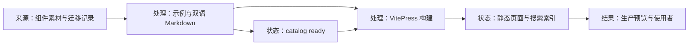
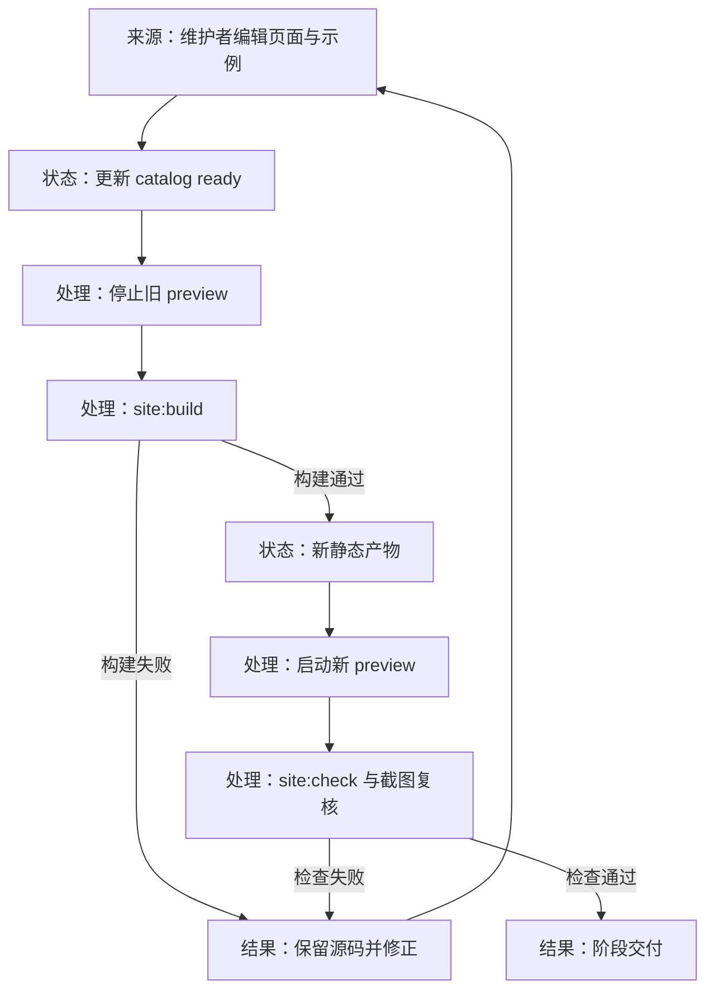
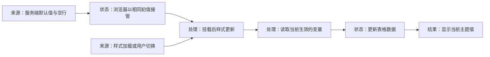

# 文档站的结构与页面验证

本文面向维护文档站的开发者，说明页面、示例、目录和生产检查的职责。内容编写约束以 [组件页面工作流](../../rules/workflows/site-component-page.md) 为准。

## 内容如何变成页面



| 位置 | 职责 |
| --- | --- |
| `site/components/`、`site/en/components/` | 中英文组件标题、用法提示、映射差异；两种语言共享示例 |
| `site/examples/<slug>/*.vue` | 可复制使用的 Vue 示例，使用英文内容 |
| `site/guide/`、`site/en/guide/` | 安装、暗色、主题变量等指南 |
| `site/.vitepress/catalog.ts` | 组件分组与发布状态；只将 ready 组件放进侧栏 |
| `site/.vitepress/config.mts` | 语言导航、指南侧栏、搜索和 demo 容器 |
| `site/.vitepress/theme/components/Demo.vue` | 按需加载示例组件，渲染预览和源码操作区 |
| `site/scripts/copy-styles.mjs` | 把已构建主题（含 `glass.css`）与 Element Plus 原版样式复制到 public/styles |
| `site/.vitepress/theme/components/GlassSwitch.vue` | 顶栏和手机菜单里的「毛玻璃」开关，给 `<html>` 加 / 去掉 `glass` 类，选择记在 `site-glass` |
| `site/examples/assets/` | 不依赖远程服务的小体积示例图片，示例里用 import 引用 |
| `site/scripts/check-pages.mjs` | 生产页面的语言、亮暗、主题组合检查与截图 |

`::: demo input/basic` 在构建时读取示例源码生成代码块；Demo 用 `import.meta.glob`（非 eager）找到同一个示例，作为异步组件渲染，不需要再登记组件。每个示例单独打包，页面只加载自己用到的示例，所有页面共用的主题包不会随示例数量增长。页面的章节标题放在 demo 容器外，右侧目录和本地搜索才能收录。

`::: demo date-picker/basic client-only` 让预览区只在浏览器里渲染（用 `<ClientOnly>` 包住预览区），代码块仍然预渲染，页面加载时不会因为整个示例框后出现而跳动。

## 变更流转与验收



编辑源文件后，当前 preview 仍展示上次构建。重新构建会替换静态目录；应先停止旧 preview，再构建并启动新 preview，避免旧服务引用已经删除的带哈希资源。构建和检查失败时回到源码修正，不沿用旧报告宣告成功。

```sh
pnpm site:build
pnpm --filter site preview --port 5191
pnpm site:check input select
```

第二条命令在独立终端运行。省略最后一条的页面参数会发现全部 ready 组件和中文指南目录里的全部指南，并检查每个目标的两种语言。指南可用 `pnpm site:check guide/quick-start` 单独检查；`--base` 指向其他生产预览地址。

检查覆盖中文 / 英文 × 亮色 / 暗色 × Arco / Element Plus 八种组合，检查控制台错误、Vue 告警、空示例、页面导航与根主色；截图、Markdown 和 JSON 报告在 `site/.check/`，不纳入 Git。自动检查不判断图标、交互和所有几何细节，仍需打开截图，操作弹出层并复核布局。

主色来自当前主题源码：Arco 亮色为 `#165dff`，暗色为 `rgb(60, 126, 255)`，Element Plus 两种外观均为 `#409eff`。暗色不可按亮色值判定。

## 样式切换为何使用样式表对象

四个带 `data-site-style` 的 link 标签分别加载 Arco / Element Plus 的亮色和暗色文件。所有属性保持固定，通过 `link.sheet.disabled` 停用另一套样式：

- VitePress 换页会比对 head 标签的全部属性，修改属性会导致默认 link 被重新插入，主题选择丢失。
- Chrome 在样式表尚未加载时设置 `link.disabled` 不可靠；启动脚本在样式表可用后操作 sheet，并在后来插入的 link 加载时补应用。
- `site-theme` 保存 Arco / Element Plus 选择，`vitepress-theme-appearance` 保存亮暗选择；页面和示例不直接修改这些 link。

生产构建和开发服务器对 head 的处理不同，最终验收采用生产 preview。

## 毛玻璃开关

`glass.css` 也是一个带 `data-site-style="arco"` 的 link（排在 `arco-dark.css` 之后），属于 Arco 这一套：切到「EP 原版」时随它一起停用，这时顶栏的开关置灰。`glass` 类由启动脚本在页面渲染前按 `site-glass` 加上，刷新不闪。

玻璃要叠在背景上才看得出来，文档站在 `custom.css` 里给 `html.glass` 铺了一层渐变壁纸，顶栏、侧栏改成半透明加模糊。手机（< 960px）上侧栏、菜单、本页目录条是盖在内容上的抽屉，下面还有一层暗色遮罩，半透明的底会透出被压暗的页面而发灰，所以那里换成更实的玻璃底（0.88 / 0.9）。

## 服务端渲染与交互示例



变量表在挂载后首次读取；样式加载或外观切换再触发刷新。这样服务端与浏览器初值一致，新值在样式生效后展示，切回旧主题仍通过同一条刷新路径。

SSR（服务端渲染，构建时在 Node 中生成 HTML）不提供 window 或 document。消息、通知、全屏加载等服务放在按钮事件中调用；模板目标通过 ref 在浏览器挂载后使用。

主题入口已经提供 Element Plus 的 ID 和层级注入。部分带弹出层的组件仍可能出现水合（浏览器接管已生成 HTML）不一致，Steps 也可能因子节点注册时机而出现错误的初始状态；确认渲染问题后在 demo 容器上加 `client-only` 标记，示例源文件仍保持正常 Vue 写法，便于复制到应用。不要以关闭告警或过滤错误作为修复。

Dialog、Drawer、Tour、图片预览按正常点击打开；日期、颜色、级联选择器可以用 Element Plus 的内联面板直接展示。示例不搬用 playground 的测量标记、静态弹层容器或强制展开设置。

## 正文排版不作用于示例

VitePress 的正文排版（`vp-doc.css`）给链接、列表、表格、按钮都定义了样式，原样作用于预览区会改掉组件的样式，例如表头颜色、各尺寸字号、按钮和标签关闭按钮的边距、Anchor 的焦点颜色。

预览区带 `vp-raw` 类，`config.mts` 用 VitePress 自带的 `postcssIsolateStyles` 处理 `vp-doc.css`：每条选择器都加上 `:not(:where(.vp-raw, .vp-raw *))`，正文排版就不会进入预览区。`:where()` 不增加优先级，正文其他地方的样式效果不变。

早期做法是在 custom.css 里逐个组件修补被覆盖的属性，问题是补不全（漏了表格的颜色和字号）、会压掉组件自己的规则（按钮一律 `margin: 0` 压掉了 Transfer 按钮、Tag 关闭按钮、Upload 列表的边距），而且主题改了组件样式后，文档站里看不到。改成隔离后这段修补全部删除，用全站逐页截图对比确认：其余差异都是组件回到了真实效果。

唯一保留的预览区规则：预览区是 `display: flex; gap: 12px`，直接并排的按钮由 gap 间隔，所以去掉 EP `.el-button + .el-button` 的 12px 左边距，避免叠成 24px；示例自己容器里的按钮不受影响。页面容器尺寸写在示例内部，只有复用布局才增加 demo 前缀辅助类。

区分正文影响与主题问题时，可把同一组件移出 vp-doc 比较。Descriptions 的无边框纵向布局在移出正文后仍异常，已记录在 [组件迁移记录](../components/19-descriptions.md)，由主题包另行修复。

## 已确认的边界

- 设计变量与全局变量表曾在浏览器初始化时立即读取样式，分别与服务端的默认颜色表达式、空行不一致，导致 16 种组合出现水合错误。用户授权的最小修复移除立即读取，沿用 useStyleTick 挂载后的刷新，不改变布局、变量映射或主题切换。

- 标准检查视口为 1440 × 1000。1280px 宽度下发现现有框架侧栏遮挡正文，属于站点框架的独立问题。
- var.scss 虽然导出，但当前 $colors 没有声明 !default，不能通过 @use with 配置覆盖；主题定制指南只介绍已确认的变量用法。
