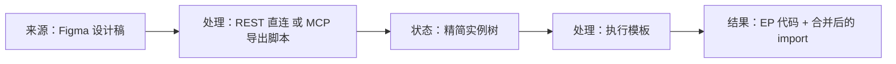

# Figma 组件库与设计稿转代码

本文说明配套 Figma 组件库的结构，以及把设计稿转成 Element Plus 代码的工具（[`packages/figma`](../../../packages/figma/)）为什么这样设计。维护时必须遵守的步骤见 [Figma 工作流](../../rules/workflows/figma-kit.md)；面向使用者的说明在文档站 [Figma](../../../site/guide/figma.md)。

## 组件库「Arco for Element Plus · UI Kit」

对外发布在 Figma Community：<https://www.figma.com/community/file/1702742375809666570>。维护用的源文件：<https://www.figma.com/design/poAXj8MRPolt3HKremBdRA>（tuling 团队），改源文件后在 Community 发布更新。数值全部取自主题构建产物（`packages/theme-arco/dist` 里的最终 CSS 变量）和 `src/glass/_tokens.scss`，不是手调的。

### 变量

| 集合 | 模式 | 内容 |
| --- | --- | --- |
| Primitives | Value | Arco 亮色、暗色两套 10 级色板（`arcoblue`、`green`、`orange`、`red`、`gold`、`gray`、`dark/*`），隐藏不出现在属性面板 |
| Theme | Light / Dark / Glass Light / Glass Dark | 语义颜色（`color/*`、`text/*`、`bg/*`、`fill/*`、`border/*`，以及 `input/*`、`button/*`、`state/*`、`mask/*` 等组件级语义），外加随玻璃模式变化的圆角（`radius/button`、`radius/surface`、`radius/overlay`……） |
| Size | Value | 不随主题变化的圆角、间距、字号 |
| Control Size | Default / Small / Large | 控件高度、按钮内边距、标签高度等，对应 EP 的 `size` |

几个设计决定：

- **四个主题模式放在同一个集合里**。玻璃模式改的是中性色（底、填充、分隔线）和少数圆角，状态色沿用亮 / 暗。合并成一个集合，设计师切一次模式整套配色就变，也正好用满 Professional 套餐每个集合 4 个模式的上限。
- **尺寸用变量模式，不做变体**。EP 的 `size` 是全局可配的（ConfigProvider），Figma 里对应「给外层 Frame 切模式」最自然；如果做成变体，Button 会从 120 个变体膨胀到 360 个。Switch 的三档尺寸差别不只是高度，所以单独做了 `Size` 变体。
- **玻璃的模糊不进变量**。Figma 的效果不能随变量模式切换，浮层的背景模糊做成效果样式 `Glass/Overlay`，由设计师在玻璃模式下手动加上。
- **每个变量都写了 Web code syntax**（`var(--el-color-primary)` 等），Dev Mode 里直接显示主题的 CSS 变量名。

### 页面与组件

Cover、Getting Started（四个主题模式的实时预览和尺寸预览）、Colors、Typography & Effects、Icons（Element Plus 图标），以及按 EP 文档分组的 Basic / Form / Data Display / Navigation / Feedback / Others。

- 变体按 EP 的属性划分：Button 是 `Type × Style × State`，`Style` 对应 `plain` / `dashed` / `text` / `link`；Hover / Focus / Active 这类交互态也做成变体，方便画交互稿。
- 图标是 58 个独立组件，组件里用 INSTANCE_SWAP 属性替换，不为每个图标做变体。
- 组合组件（Dialog、Tabs、Menu、Steps、Table……）内部使用其他组件的实例，转代码时据此生成子组件。

## 设计稿转代码

### 为什么不用官方 Code Connect

Figma 官方的 Code Connect 能在 Dev Mode 里直接显示代码，但发布需要 Organization / Enterprise 套餐。工具改为在本地执行同一套模板：模板文件 `templates/**/*.figma.ts` 就是官方的 parserless 模板格式（`figma.code` + `instance.getEnum` 等 API），[`lib/runner.mjs`](../../../packages/figma/lib/runner.mjs) 在 Node 里模拟这套 API。以后有了 Organization 套餐，同一批模板可以直接用官方 CLI 发布。

### 数据流

| 文件 | 职责 |
| --- | --- |
| [`lib/rest.mjs`](../../../packages/figma/lib/rest.mjs) | 用个人访问令牌调用 `GET /v1/files/:key/nodes`，把节点树转成精简实例树 |
| [`extract.js`](../../../packages/figma/extract.js) | 同样的转换逻辑，写成 Figma 插件 API 脚本，交给 Figma MCP 的 `use_figma` 执行 |
| [`lib/runner.mjs`](../../../packages/figma/lib/runner.mjs) | 加载模板、模拟模板 API、执行、合并 import |
| [`bin/cli.mjs`](../../../packages/figma/bin/cli.mjs) | 命令行：直接传链接走 REST；`extract` / `run` 走 MCP；没有令牌时退出码 2 |
| [`templates/`](../../../packages/figma/templates/) | 每个 Figma 组件一个模板，文件头 `// figma=<组件名>` 用于匹配 |

### 为节省 AI 上下文做的取舍

工具主要由 AI 调用，进入 AI 上下文的数据越少越好：

- **REST 直连优先**：AI 只执行一条命令，上下文里只出现最终代码。只在没有令牌或额度不够时才走 MCP。
- **精简实例树**：实例写成 `{ c, p, k }`，换图标的属性记成 `"@Icon/Search"`；不导出文字图层、组件内部的图标子节点、隐藏图层和不含实例的装饰图层。一个 17 个组件的面板约 2.4KB。
- **Skill 而不是项目说明**：Claude Code 插件里的 skill 平时只占描述，遇到 Figma 链接才加载正文；也免去在每个项目的 `CLAUDE.md` 里写说明。

### 模板约定

- 先拼好代码字符串 `code`，`example` 写成 `` figma.code`${code}` ``，同时放进 `metadata.props.code`。父模板通过 `findConnectedInstances(...).map(n => n.executeTemplate().metadata.props)` 读取子模板的字符串来组合，这是官方 API 里跨模板传值最稳定的方式（不直接拼接模板结果）。
- 图标模板在 `metadata.props.iconName` 里给出图标名，父模板据此生成 `:icon="Search"` 并自己声明 import。执行器在嵌套执行图标模板时不收集它的 import，避免父模板只读了图标名，却把没用到的图标也加进 import。
- `codeConnectId()` 只从模板源码读取 `id`，不执行模板，原因同上。

### 为什么是独立的包

模板对应的是 Figma 组件库，不是主题的 CSS，两者不需要一起发版；而且不是每个使用主题的人都用 Figma。所以转代码工具单独发布为 `element-plus-theme-arco-figma`，主题包 `element-plus-theme-arco` 不包含它。

## 已知边界

- 只识别从组件库拖出的组件实例；自绘图形、纯文字、布局和间距需要对照设计稿实现。
- 交互态变体（Hover / Focus / Active）不生成代码。
- 尺寸用变量模式表达，REST 和插件 API 都读不到实例上的模式，所以不会生成 `size`。
- Menu 的子菜单层级在设计稿里只靠缩进表示，生成的 `el-sub-menu` 里只有占位注释。
- `v-model`、`:data` 等是占位绑定；`<!-- xxx initial value: ... -->` 注释记录设计稿里的选中状态。
- REST 额度按席位计算：View / Collab 席位每月只有约 20 次，这类用户应走 MCP。
